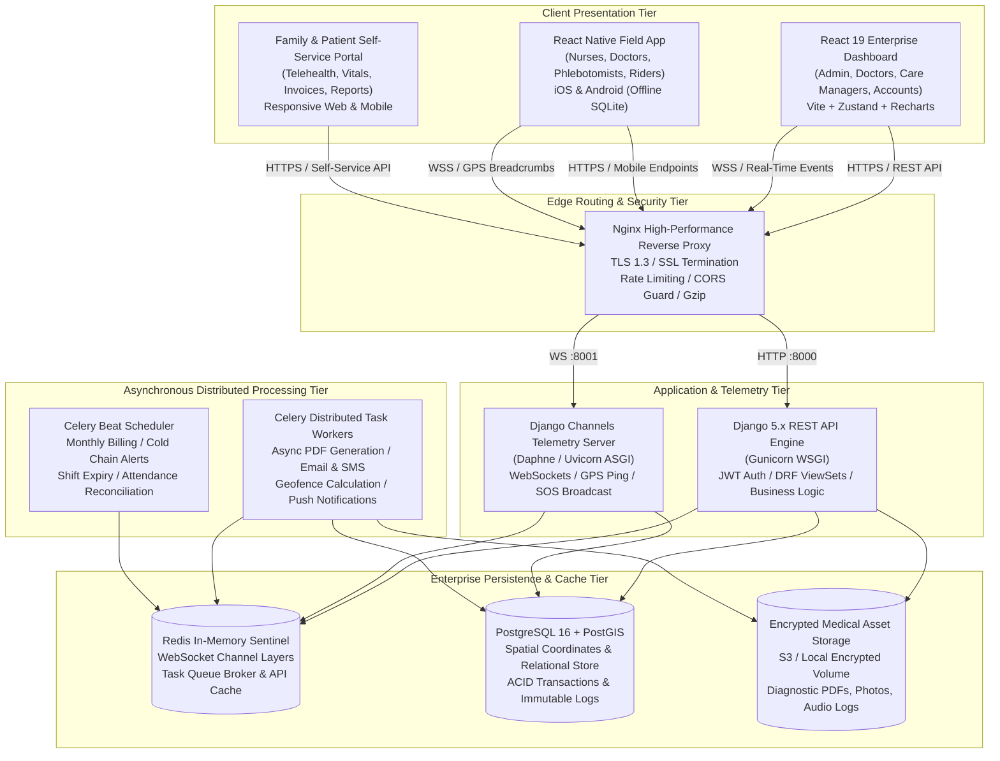
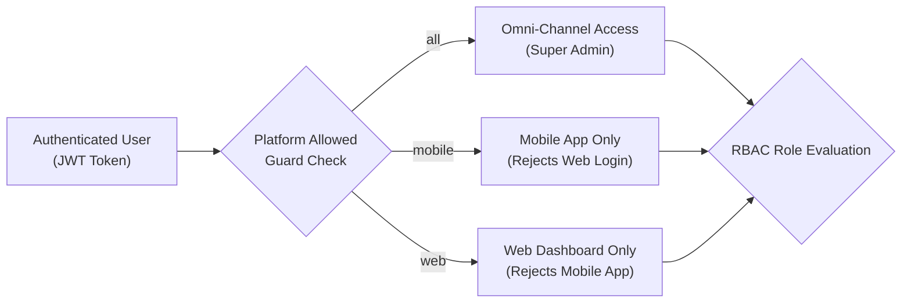
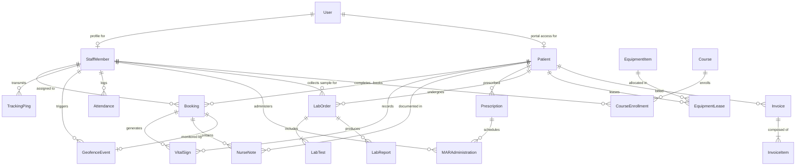
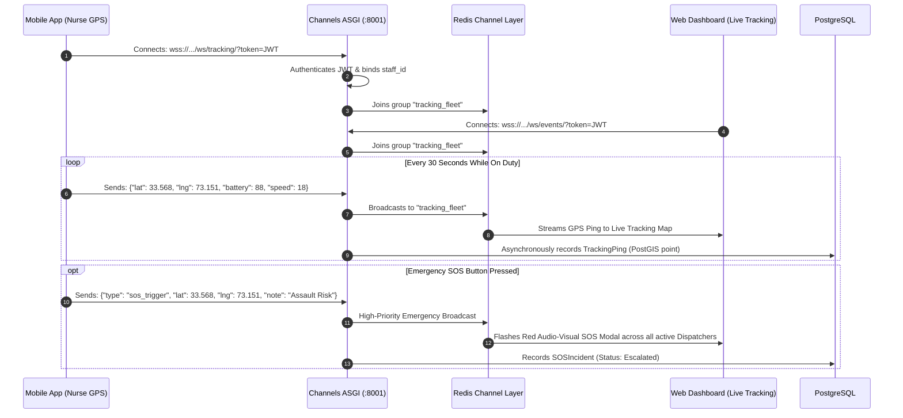
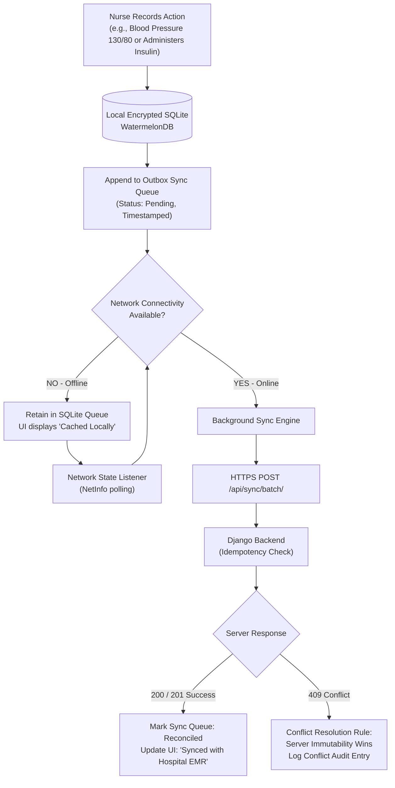
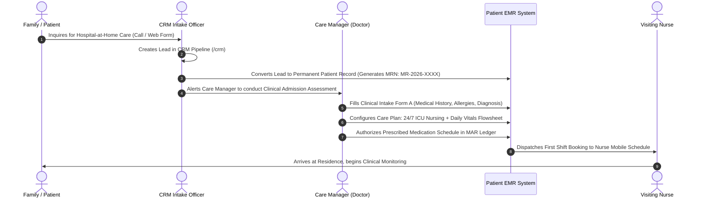
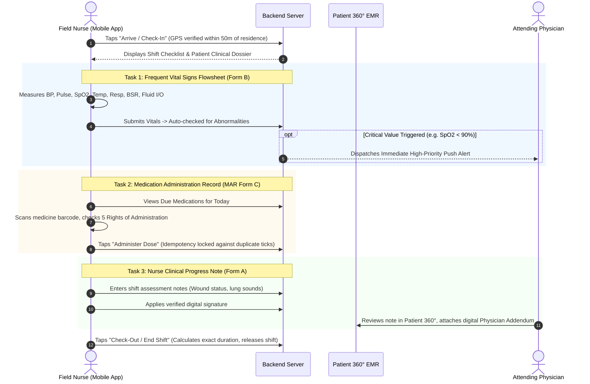
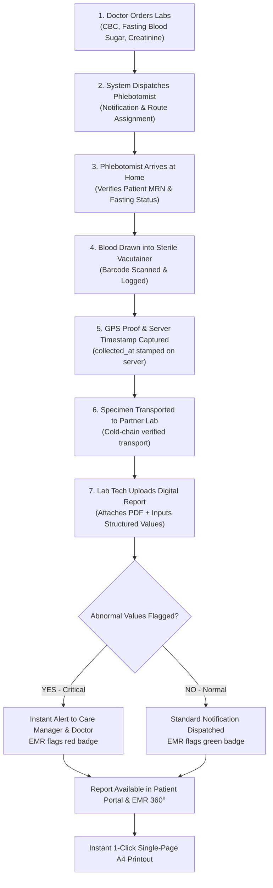
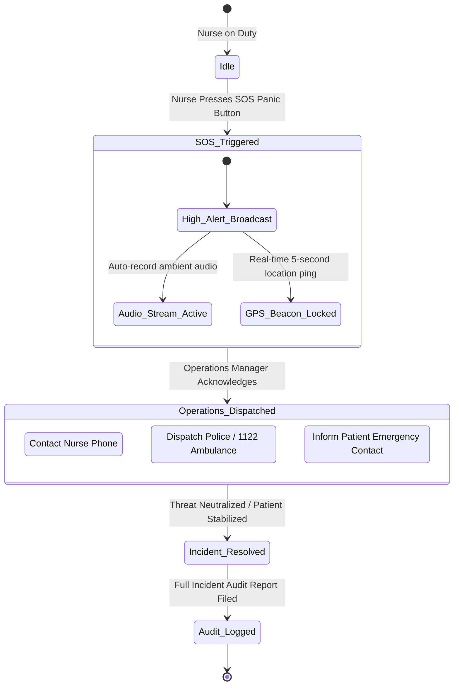

# HomeCare OS — Enterprise System Architecture Specification
## World-Class "Hospital-at-Home" Digital Operating System & Clinical Telemetry Platform

> **Document Status:** Official Production Architecture Blueprint (v4.0)  
> **Classification:** Confidential Enterprise Healthcare Architecture  
> **System Name:** eHealth HomeCare OS & Telemetry Network  
> **Accreditation Standards:** SECP Reg # 0192834 | IHRA Licensed Healthcare Provider # IHRA-2024-089  
> **Regulatory Compliance:** HIPAA Privacy & Security Rules, HL7/FHIR Clinical Data Standards, ISO 27001, GDPR  

---

## 1. Executive Architecture Summary

**HomeCare OS** is a mission-critical, enterprise-grade healthcare operating system engineered to deliver hospital-level clinical care, acute telemetry monitoring, rehabilitation therapies, phlebotomy diagnostics, and pharmaceutical logistics directly within patient residences.

The architecture solves the complex operational, clinical, and regulatory challenges of decentralized healthcare:
- **Zero-Trust Clinical Security:** Granular Role-Based Access Control (RBAC) across 12 distinct healthcare personas.
- **Bi-Directional Telemetry & Tracking:** Sub-second WebSockets streaming live GPS coordinates, battery metrics, geofence check-ins, and emergency SOS alerts.
- **Offline-First Resilient Mobile Architecture:** Store-and-forward SQLite synchronization ensuring uninterrupted nursing logs and medication administration even in remote areas lacking cellular connectivity.
- **Immutable Clinical Audit Trail:** Server-enforced immutable timestamps (`collected_at`, `recorded_at`), electronic signatures, and tamper-evident medical record audit trails complying with IHRA and SECP regulations.
- **Single-Page Universal Medical Printing:** Strict A4 portrait calibrated print layout engine with hospital letterhead, demographics, structured clinical tables, and authenticated seal cryptography.

---

## 2. High-Level System Topology (C4 Container Architecture)



---

## 3. Profiles & Role-Based Access Control (RBAC) Matrix

HomeCare OS enforces strict role segregation. The system implements a **Dual-Gate Security Model**:
1. **Network & Platform Gate:** Field staff (nurses, phlebotomists, riders) are restricted to the mobile app; administrative and finance personnel are restricted to the web console.
2. **Permission Matrix Gate:** Fine-grained module-level read, write, edit, and delete permissions.



### Detailed Persona Specifications

| Persona Role | Target Personnel | Allowed Platform | Core Modules Accessible | Clinical & Operational Authority |
| :--- | :--- | :--- | :--- | :--- |
| **`super_admin`** | Medical Director / CEO / Head of Operations | All (Web + Mobile) | All 19 Modules (EMR, Staff, Accounts, Billing, LMS, Users, SOS) | Full root authority, role editing, financial write-offs, audit trail inspection. |
| **`admin`** | Operations Director / Operations Coordinator | Web Dashboard | Overview, Bookings, Tracking, Patients, Therapy, Lab, Pharmacy, Equipment, LMS | Staff rostering, booking management, service dispatch, equipment rentals. |
| **`branch_manager`** | Regional Branch Manager | Web Dashboard | Overview, Bookings, Tracking, Patients, Inventory, Reports, Regional Staff | Regional territory supervision, phlebotomy assignments, localized dispatch. |
| **`care_manager`** | Attending Consultant / Head Nurse Coordinator | Web Dashboard | Patients, Patient 360°, Bookings, Tracking, Therapy, Labs, Pharmacy | Clinical care plan authorization, medication adjustments, lab review, alert triage. |
| **`nurse`** | Visiting Registered Nurse (RN / BSN) | Mobile App (Field) | My Schedule, Active Visit, Vitals (Form B), Nurse Notes (Form A), MAR (Form C), SOS | Bedside vitals recording, aseptic wound care, IV infusions, medication administration. |
| **`doctor`** | Home Visiting Specialist / Tele-Consultant | Web & Mobile | Patient 360°, Tele-Consult, e-Prescriptions, Clinical Orders, Addenda | Bedside physical exam, medication prescription, diagnostic order authorization. |
| **`physio`** | Doctor of Physical Therapy (DPT) | Mobile App (Field) | My Schedule, Active Visit, Mobility Tracking, ROM Protocols, Feedback | Neuro rehab, stroke recovery protocols, gait training, therapeutic exercise logs. |
| **`psychologist`** | Clinical Psychologist / Counselor | Web & Mobile | Tele-Therapy, Patient Notes, Assessment Forms, Cognitive Evaluation | CBT sessions, depression/anxiety scores, counseling notes, psychiatric liaison. |
| **`speech`** | Speech-Language Pathologist | Mobile App (Field) | Dysphasia Protocol, Swallowing Assessments, Exercise Logging | Post-stroke speech rehab, FEES swallowing assessments, diet texture plans. |
| **`dietician`** | Clinical Dietitian & Nutritionist | Web & Mobile | Diet Plans, Glycemic Logs, Renal Diets, Enteral Nutrition | Tube feeding calculations (NG/PEG), diabetes meal planning, nutritional consults. |
| **`phlebotomist`** | Lab Technician / Sample Collector | Mobile App (Field) | Lab Queue, Sample Collection, GPS Check-In, Specimen Barcode | Sterile blood draw, vacutainer labeling, GPS proof-of-collection, cold chain transport. |
| **`rider`** | Pharmacy & Consumables Delivery Courier | Mobile App (Field) | Delivery Route, Barcode Handover, Digital Signature, Cash Collect | Cold chain insulin delivery, wound dressing packs, medication delivery proof. |
| **`technician`** | Biomedical Equipment Technician | Mobile App (Field) | Equipment Dispatch, Delivery Slip, Calibration Check, Recovery | Hospital bed installation, oxygen concentrator setup, ventilator check, deposit collection. |
| **`accountant`** | Chief Financial Officer / Billing Officer | Web Dashboard | Accounts, Invoices, Patient Packages, General Ledger, Claims, Revenue | Invoice generation, discount authorization, payment reconciliation, ledger exports. |
| **`crm_executive`** | Patient Relationship Manager / Sales Intake | Web Dashboard | CRM Leads, Inquiries Pipeline, Conversion Funnel, Follow-Ups | Inbound call logging, homecare package consultations, patient onboarding conversion. |
| **`patient_family`** | Patient / Authorized Family Next-of-Kin | Family Portal | Vitals Dashboard, Visit Timeline, Medication List, Invoices, Lab Reports | Real-time visit monitoring, nurse arrival ETA, digital report downloads, bill payment. |

---

### Comprehensive RBAC Permission Matrix

```
Legend: [V] View | [C] Create/Add | [E] Edit/Update | [D] Delete
```

| Module / Resource | Super Admin | Admin | Care Manager | Nurse / Doctor | Therapist | Phlebotomist | Accountant | CRM | Patient / Family |
| :--- | :---: | :---: | :---: | :---: | :---: | :---: | :---: | :---: | :---: |
| **Overview & KPIs** | V C E D | V | V | — | — | — | V | V | — |
| **Bookings & Shifts** | V C E D | V C E | V C E | V (Assigned) | V (Assigned) | V (Assigned) | V | V C | V (Self) |
| **Live GPS Tracking** | V C E D | V | V | Ping Only | Ping Only | Ping Only | — | — | ETA View |
| **Patients & EMR 360°**| V C E D | V C E | V C E | V E (Clinical) | V E (Therapy) | V (Sample) | V (Billing) | V (Intake) | V (Self) |
| **Vitals (Form B)** | V C E D | V | V C E | V C | — | — | — | — | V (Self) |
| **Nurse Notes (Form A)**| V C E D | V | V C E | V C (Addenda) | — | — | — | — | — |
| **MAR Medications** | V C E D | V | V C E | V C (Give) | — | — | — | — | V (Self) |
| **Diagnostic Labs** | V C E D | V C E | V C E | V (Order) | — | V C (Sample) | V (Billing) | — | V (Report) |
| **Pharmacy & Refills**| V C E D | V C E | V C E | V (Rx) | — | — | V (Billing) | — | V (Self) |
| **Equipment Rentals**| V C E D | V C E | V | — | — | — | V (Billing) | — | V (Self) |
| **Form Builder Studio**| V C E D | V C E | V | — | — | — | — | — | Fill Only |
| **Billing & Invoices**| V C E D | V | V | — | — | — | V C E D | — | V (Pay) |
| **LMS Training** | V C E D | V C E | V | V (Learn) | V (Learn) | V (Learn) | — | — | — |
| **User Management** | V C E D | — | — | — | — | — | — | — | — |

---

## 4. Server & Backend Architecture (`backend/`)

The backend is organized into 18 specialized Django applications, following Domain-Driven Design (DDD):

```
backend/
├── accounts/          # User identities, JWT tokens, security audit, platform guards
├── billing/           # Invoicing, ledgers, patient packages, payment reconciliation
├── bookings/          # Visit bookings, recurring care plans, shift management
├── crm/               # Lead intake, customer pipeline, conversion tracking
├── documents/         # Medical document archives, consent forms, attachments
├── equipment/         # Hospital beds, oxygen concentrators, leasing & deposits
├── forms_builder/     # Real-time form builder, dynamic questions, printable layouts
├── homecareOS/        # Core ASGI/WSGI configs, routing, permissions, event bus
├── lab/               # Diagnostic tests catalog, home phlebotomy, GPS collection proof
├── lms/               # Staff training courses, exams, certifications, video CDN
├── notifications/     # Multi-channel push, SMS, email, emergency alerts
├── patients/          # Core EMR, Vitals (Form B), Notes (Form A), MAR Sheet (Form C)
├── pharmacy/          # e-Prescriptions, medication dispensing, cold-chain monitoring
├── portal/            # Patient & family portal telemetry API
├── quality/           # Clinical audit logs, supervisor signatures, incident reports
├── reports/           # Universal ReportLab PDF engine, analytics exports
├── staff/             # Staff directory, geofenced attendance, credentials, payroll
└── tracking/          # GPS breadcrumb ingestion, WebSocket dispatcher, SOS panic
```

---

### Entity-Relationship Architecture (Core Models)



---

### Real-Time WebSocket Telemetry Architecture

The WebSocket telemetry engine uses **Django Channels** backed by a **Redis In-Memory Channel Layer**:



---

## 5. Mobile App Architecture (`mobile/`)

The mobile application is a high-reliability React Native client built for offline field operations.

```
mobile/
├── src/
│   ├── api/             # Axios instance with auto JWT refresh & interceptors
│   ├── db/              # WatermelonDB / SQLite local encrypted persistence
│   ├── sync/            # Store-and-Forward bi-directional offline sync engine
│   ├── store/           # Zustand reactive state management
│   ├── screens/         # Role-tailored native screens
│   │   ├── auth/        # Login, Biometric FaceID, OTP Password Reset
│   │   ├── schedule/    # Today's Visits, Route Map, Navigation Integration
│   │   ├── clinical/    # Vitals (Form B), Nurse Notes (Form A), MAR (Form C)
│   │   ├── lab/         # Phlebotomy list, GPS specimen collection proof
│   │   ├── emergency/   # Instant SOS Panic button with hardware trigger
│   │   └── training/    # LMS Course player, video download & offline exams
│   ├── hardware/        # Hardware bridges: BLE Vitals, Camera Barcode, GPS
│   └── components/      # UI component design system
```

---

### Offline-First Synchronization Architecture

In home healthcare, nurses frequently enter basements or rural residences with zero cellular reception. The platform uses a **Store-and-Forward Event Queue**:



---

### Hardware Layer Integrations

1. **Bluetooth Low Energy (BLE) Medical Telemetry:**
   - Pairs with standard Continua-certified medical devices (Contec Pulse Oximeter, Omron Bluetooth BP Monitor, Accu-Chek Instant Glucometer).
   - Raw byte stream is parsed via Web Bluetooth / React Native BLE PLX protocols and populates Vitals Form B without manual transcription errors.
2. **Camera Barcode & QR Verification:**
   - **Specimen Vacutainers:** Scans the unique barcode on the blood tube prior to drawing.
   - **Medication Unit Dose:** Scans the blister pack barcode before administering via MAR Sheet (prevents medication errors).
   - **Patient Identity Wristband:** Scans patient QR code on arrival to confirm identity.
3. **Background Geolocation Service:**
   - Uses native Android Foreground Services and iOS Significant Location Changes.
   - Automatically detects arrival within a **50-meter geofence** of the patient's home, prompting the nurse to confirm visit check-in.

---

## 6. End-to-End Operational Workflows

### Workflow 1: Complete Patient Onboarding & Clinical Intake



---

### Workflow 2: Bedside Nursing Shift Execution (Forms A, B & C)



---

### Workflow 3: Diagnostic Home Phlebotomy Lifecycle



---

### Workflow 4: Emergency SOS Incident Escalation Protocol



---

## 7. Infrastructure, Containerization & High Availability

The entire application runs under production-ready Docker containers orchestrated with Docker Compose:

```
                    ┌───────────────────────────────┐
                    │  Internet (Cloudflare / WAF)  │
                    └───────────────┬───────────────┘
                                    │ HTTPS (443)
                                    ▼
┌───────────────────────────────────────────────────────────────────────┐
│                           HOST INSTANCE                               │
│                                                                       │
│  ┌─────────────────────────────────────────────────────────────────┐  │
│  │                     nginx (Reverse Proxy)                       │  │
│  │        Port 80/443 -> SSL Termination, Static Cache, Gzip       │  │
│  └──────────────┬──────────────────────────────────┬───────────────┘  │
│                 │ /api, /admin                     │ /ws              │
│                 ▼                                  ▼                  │
│  ┌───────────────────────────────┐  ┌──────────────────────────────┐  │
│  │    backend_web (Gunicorn)     │  │   backend_asgi (Daphne)      │  │
│  │    Django WSGI (4 Workers)    │  │   Django ASGI (4 Workers)    │  │
│  └──────────────┬────────────────┘  └──────────────┬───────────────┘  │
│                 │                                  │                  │
│                 │           ┌──────────────┐       │                  │
│                 ├──────────►│ redis:6379   │◄──────┤                  │
│                 │           │ Channel Layer│                          │
│                 │           └──────┬───────┘                          │
│                 │                  │                                  │
│                 │                  ▼                                  │
│                 │           ┌──────────────┐                          │
│                 │           │ celery_worker│                          │
│                 │           │ Async Tasks  │                          │
│                 │           └──────────────┘                          │
│                 │                  │                                  │
│                 │                  ▼                                  │
│                 │           ┌──────────────┐                          │
│                 │           │ celery_beat  │                          │
│                 │           │ Periodic Cron│                          │
│                 │           └──────────────┘                          │
│                 │                  │                                  │
│                 ▼                  ▼                                  │
│  ┌─────────────────────────────────────────────────────────────────┐  │
│  │                     postgres (PostgreSQL 16)                    │  │
│  │              Encrypted Data Volume, PostGIS Extension           │  │
│  └─────────────────────────────────────────────────────────────────┘  │
└───────────────────────────────────────────────────────────────────────┘
```

### Production Docker Services Definition

| Service Name | Base Image | Role & Scaling Strategy | Health Check Endpoint |
| :--- | :--- | :--- | :--- |
| **`nginx`** | `nginx:alpine` | SSL termination, reverse proxy, static file server, rate limiter. | `GET /nginx-health` |
| **`backend_web`** | `python:3.11-slim` | Handles synchronous REST API requests via Gunicorn (4 worker processes). | `GET /api/health/` |
| **`backend_asgi`**| `python:3.11-slim` | Handles asynchronous WebSockets (GPS pings, live alerts) via Daphne/Uvicorn. | WebSocket ping |
| **`celery_worker`**| `python:3.11-slim` | Processes background jobs: PDF generation, SMS/Email dispatch, geofence checks. | Celery inspect ping |
| **`celery_beat`** | `python:3.11-slim` | Schedules periodic cron jobs (monthly invoices, shift reconciliation). | Heartbeat file |
| **`redis`** | `redis:7-alpine` | In-memory message broker for Celery and Channels channel layer. | `redis-cli ping` |
| **`postgres`** | `postgres:16-alpine`| Primary relational database with PostGIS spatial extensions. | `pg_isready -U postgres` |

---

## 8. Regulatory EHR Standards & Data Governance Compliance

### 1. Electronic Medical Record Immutability Rules
- **Server-Controlled Timestamps:** Clinical records (`VitalSign`, `NurseNote`, `MARAdministration`, `LabReport`) enforce `auto_now_add=True` on the database level. Mobile clients cannot falsify timestamps; server time is strictly enforced.
- **Append-Only Clinical Addenda:** Once a clinical note is signed by a nurse or doctor, it cannot be edited or overwritten. Any subsequent corrections must be appended as an `Addendum` with the author's identity and timestamp.

### 2. Digital Signatures & Authenticated Stamp Seals
- Documents generated through the system (Vitals Flowsheet Form B, Intake Form A, Lab Reports) embed verified digital signatures alongside an official circular hospital stamp seal with cryptographic hash audit strings.

### 3. Patient Health Information (PHI) Security
- **Encryption in Transit:** All traffic enforced via TLS 1.3 with HSTS headers.
- **Encryption at Rest:** Sensitive health records, diagnostic PDFs, and telemetry databases are encrypted using AES-256.
- **Security Audit Logging:** Every profile access, patient dossier inspection, and document export is automatically logged into `accounts.models.SecurityAudit` capturing user ID, IP address, user agent, and timestamp. Retention period: 7 years per regulatory standards.
