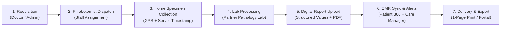
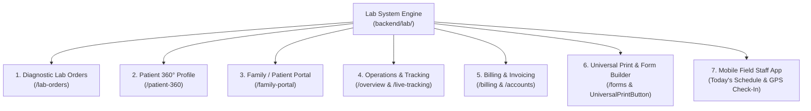
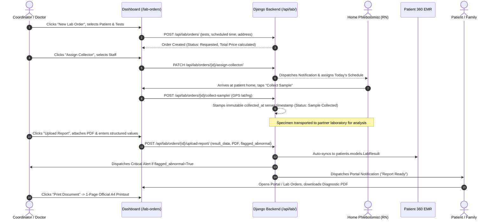

# HomeCare OS — Diagnostic Lab Report System & Workflow Architecture

> **Official System Guide & Standard Operating Procedure (SOP)**  
> **Platform:** eHealth HomeCare OS & Hospital-at-Home EHR  
> **Regulatory Standards:** SECP Reg # 0192834 | IHRA Licensed Healthcare Provider # IHRA-2024-089  

---

## 1. Executive Overview

The **Diagnostic Lab Report System** in HomeCare OS manages the entire lifecycle of diagnostic pathology investigations—from initial doctor requisition and home phlebotomy dispatch to GPS-verified sample collection, laboratory partner processing, digital PDF report delivery, and longitudinal EMR integration.



---

## 2. Official Lab Report Format Specification

Every diagnostic pathology report generated or printed in HomeCare OS adheres to standard healthcare clinical document architecture, fitting cleanly onto a single A4 page.

### 2.1 Anatomy of a HomeCare OS Lab Report

| Section | Key Clinical Elements | Purpose / Compliance |
| :--- | :--- | :--- |
| **1. Header & Letterhead** | Hospital Name (`eHealth Hospital At Home`), Logo, Tagline, UAN Phone (`+92 (51) 111-343-258`), Address, Web, SECP / IHRA Reg # | Official institutional branding and legal accreditation |
| **2. Patient Demographics & Requisition Box** | Full Name, Medical Record Number (`MRN`), Age / Gender, Contact, Requisition ID (`LAB-XXXX`), Fasting Status, Referring Physician | Unambiguous specimen-to-patient identity verification |
| **3. Specimen Provenance & Chain of Custody** | Sample Type (`Blood`, `Urine`, `Sputum`), Scheduled Collection Time, Verified Server Timestamp (`collected_at`), Phlebotomist Name & Staff ID, GPS Coordinates | Legal proof of home phlebotomy execution (prevents sample tampering/backdating) |
| **4. Structured Diagnostic Investigation Table** | Test Name, Observed Parameter, Observed Value, Units of Measure, Biological Reference Interval, Abnormality Flag | Clear clinical comparison against standard medical ranges |
| **5. Abnormality & Critical Alert Banner** | `NORMAL FINDINGS` (Green Badge) vs `ABNORMAL VALUES FLAGGED` (Red Alert Badge) | Instant triage flag for attending physicians and care managers |
| **6. Pathologist Clinical Remarks** | Consultant interpretation, diagnostic notes, follow-up recommendations | Diagnostic synthesis by qualified pathologist |
| **7. Dual Attestation & Signatures** | Phlebotomist Signature + Consultant Pathologist / Lab Director Attestation | Dual clinical accountability |
| **8. Authenticated Stamp Seal & Footer** | Circular authenticated hospital seal, Page 1 of 1 indicator, Confidential EHR retention clause (7 years) | Regulatory EHR compliance and anti-forgery protection |

---

### 2.2 Visual Layout Representation (A4 Single-Page Format)

```
┌────────────────────────────────────────────────────────────────────────┐
│  [LOGO]  eHealth Hospital At Home                 REF: LAB-2026-0042   │
│          Digital Hospital & Home Clinical Care    UAN: +92 (51) 111-343│
│          Plot 14-B, Medical Enclave, Islamabad    SECP Reg # 0192834   │
├────────────────────────────────────────────────────────────────────────┤
│  PATIENT DEMOGRAPHICS & SPECIMEN REQUISITION                           │
│  Patient: Muhammad Tariq (68Y / M)   MRN: MR-2026-0042                 │
│  Sample: Blood (EDTA / Serum)        Collected: 13/Oct/2026 08:30 (GPS)│
│  Ref By: Dr. Raza Khan (Consultant)  Phlebotomist: Sarah Mitchell, RN  │
├────────────────────────────────────────────────────────────────────────┤
│  DIAGNOSTIC PATHOLOGY & LABORATORY INVESTIGATIONS                      │
│  Status: [ ABNORMAL VALUES FLAGGED (ALERT) ]                           │
│                                                                        │
│  Investigation / Parameter  Observed Value  Units    Ref Range   Flag  │
│  ────────────────────────────────────────────────────────────────────  │
│  Hemoglobin                 11.2            g/dL     13.5 - 17.5 LOW   │
│  White Blood Cells (WBC)    11,800          /mcL     4,500-11,000 HIGH │
│  Platelets                  210,000         /mcL     150k-450k   NORM  │
│  Blood Glucose (Fasting)    148             mg/dL    70 - 99     HIGH  │
│  Serum Creatinine           1.1             mg/dL    0.7 - 1.3   NORM  │
│                                                                        │
│  Consultant Remarks: Mild microcytic anemia with elevated fasting      │
│  glycemia and mild leukocytosis. Recommend clinical correlation.       │
├────────────────────────────────────────────────────────────────────────┤
│  Attending Phlebotomist: Sarah Mitchell    Pathologist: Dr. K. Farooq  │
│  Signature: ___________________________    Attestation: _____________  │
│  Date: 13/Oct/2026                         [ OFFICIAL SEAL: AUTHENTIC ]│
├────────────────────────────────────────────────────────────────────────┤
│  CONFIDENTIAL MEDICAL RECORD — EHR Regulations. Page 1 of 1            │
└────────────────────────────────────────────────────────────────────────┘
```

---

## 3. Where & How Labs are Used Across the Full Dashboard

The Lab System is deeply integrated across multiple core modules in the dashboard:



### Module Breakdown

| # | Dashboard Module | Path | How Labs Function in This Module |
| :- | :--- | :--- | :--- |
| **1** | **Diagnostic Lab Orders** | `/lab-orders` | **Primary Hub**: View all lab orders, search by patient or test name, filter by status (`Requested`, `Collector Assigned`, `Sample Collected`, `Report Ready`), manage test catalog pricing, assign phlebotomists, and upload lab reports with structured parameters. |
| **2** | **Patient 360° Profile** | `/patient-360` | **EMR Repository**: All uploaded lab results automatically sync to `patients.models.LabResult`. Attending doctors can review the patient's longitudinal diagnostic history, monitor trends, and view abnormal flags alongside vitals and medications. |
| **3** | **Family / Patient Portal** | `/family-portal` | **Self-Service**: Patients and family members can view scheduled home sample collection visits, see who is assigned to visit their home, and directly view or download official digital PDF reports once completed. |
| **4** | **Operations & Live Tracking** | `/overview` & `/live-tracking` | **Field Visibility**: Tracks phlebotomist dispatch status, pending home visits, and alerts care coordinators if a specimen is awaiting pickup or delayed beyond turnaround time. |
| **5** | **Billing & Ledger Invoicing** | `/billing` & `/accounts` | **Revenue & Packaging**: Requisition orders automatically calculate total price from `LabTest.price`, creating an invoice item for the patient package or generating a standalone diagnostic bill. |
| **6** | **Universal Print & Form Builder** | `/forms` & `UniversalPrintButton` | **Instant Output**: Every lab order can be previewed, printed on a single A4 page, or exported as standalone HTML/PDF with the hospital letterhead and authenticated stamp seal. |
| **7** | **Field Staff Mobile App** | Mobile / Field UI | **At-Home Execution**: Phlebotomist opens today's route, arrives at patient residence, and taps "Collect Sample", which automatically captures verified GPS coordinates and server timestamp. |

---

## 4. End-to-End Workflow in the Full Dashboard

The following sequence details how a diagnostic test order moves through the platform from start to finish:



### Detailed Phase Explanations

#### Phase 1: Requisition Creation
- Coordinator or doctor opens **Diagnostic Lab Orders** (`/lab-orders`).
- Clicks **"+ New Lab Order"**.
- Selects the target patient (e.g. `Muhammad Tariq (MR-2026-0042)`).
- Selects one or more diagnostic tests (e.g. `Complete Blood Count (CBC)`, `Fasting Blood Sugar (FBS)`, `HbA1c`).
- Sets scheduled collection date/time, confirms collection address, and toggles **"Fasting Required"** if applicable.
- System automatically sums `total_price` and sets status to `requested`.

#### Phase 2: Collector Assignment
- Admin clicks **"Assign Collector"** on the order card.
- Selects an available nurse or phlebotomist (e.g. `Sarah Mitchell, RN`).
- System updates status to `collector_assigned` and dispatches a notification to the staff member's schedule.

#### Phase 3: At-Home Sample Collection with GPS Proof
- When the staff member collects the sample at the patient's residence, they submit the collection report.
- The server stamps `collected_at = timezone.now()` directly on the server to prevent backdating, alongside GPS latitude and longitude.
- Status advances to `sample_collected`.

#### Phase 4: Laboratory Processing
- The specimen is transported to the accredited partner diagnostic laboratory.
- Status is updated to `processing`.

#### Phase 5: Digital Report Upload & Parameter Entry
- Once analysis completes, the coordinator or lab tech clicks **"Upload Report"**.
- Attaches the official pathology PDF report (`result_file`).
- Inputs key structured parameters (e.g. `Hemoglobin: 11.2 g/dL`, `WBC: 11,800 /mcL`).
- If any parameter is clinically alarming, toggles **"Flagged Abnormal"**.
- System saves the record and advances status to `report_ready`.

#### Phase 6: Automated Multi-Channel Synchronization
- **EMR Integration**: The backend automatically iterates over the order's tests and creates corresponding `patients.models.LabResult` entries.
- **Care Manager Notification**: If `flagged_abnormal` is true, an instant alert is sent to the assigned Care Manager.
- **Patient Portal Notification**: The patient or family portal user receives an instant notification that their report is ready.

#### Phase 7: Viewing, Printing & Export
- Anyone with authorized access can click **"View Report"** in `/lab-orders` or `/patient-360`.
- The modal displays all structured values, pathologist remarks, and a direct download button for the PDF.
- Using `UniversalPrintButton` (`type="lab_report"`), the user can print the complete official report on a single A4 page with 1 click.

---

## 5. How to Create & Print a Lab Report (Step-by-Step)

### Method A: Creating an Order in the Lab Orders Tab
1. Open the sidebar and click **Diagnostic Lab Orders** (`/lab-orders`).
2. Click **"+ New Lab Order"** in the top-right header.
3. Select the patient from the dropdown.
4. Check the desired diagnostic tests from the catalog.
5. Set the collection time and check **"Fasting Required"** if necessary.
6. Click **"Create Lab Order"**.

### Method B: Uploading the Results
1. In the **Lab Orders** list, locate the order.
2. Click **"Assign Collector"** and assign the visiting phlebotomist.
3. Click **"Mark Sample Collected"** to record the GPS check-in.
4. Once the lab completes analysis, click **"Upload Report"**.
5. Select the PDF file from your device.
6. Enter the key parameter names and values (e.g., `Hemoglobin: 13.4 g/dL`).
7. Enter any pathologist remarks and toggle **Flagged Abnormal** if values are outside normal limits.
8. Click **"Upload & Notify Patient"**.

### Method C: Printing the Official 1-Page Report
1. Open the order and click **"View Report"** (or use the **Print** icon on the order row).
2. The print preview modal opens displaying the official letterhead, patient demographics, results table, and authenticated hospital seal.
3. Click **"Print Document →"** (or press `Ctrl + P`).
4. Select your printer or choose **"Save as PDF"**. The document is pre-calibrated to fit **strictly on 1 page (A4 portrait)** with no spillover.
5. Alternatively, click **"Download HTML/PDF File"** to save an offline copy.

---

## 6. Summary of Key Database Models & API Endpoints

### Backend Models (`backend/lab/models.py`)
- `LabTest`: Diagnostic test catalog (`name`, `price`, `sample_type`, `turnaround_hours`, `preparation_instructions`, `is_active`).
- `LabOrder`: Patient requisition lifecycle (`patient`, `tests`, `status`, `collection_staff`, `scheduled_collection_time`, `collected_at`, `collection_latitude`, `collection_longitude`, `total_price`).
- `LabReport`: Pathology report file and structured data (`lab_order`, `result_file`, `result_data`, `uploaded_by`, `flagged_abnormal`, `clinical_remarks`, `uploaded_at`).

### REST API Endpoints (`backend/lab/urls.py`)
- `GET /api/lab/tests/` — Search test catalog.
- `POST /api/lab/orders/` — Create new patient lab requisition.
- `GET /api/lab/orders/` — List orders with filters (`status`, `patient_id`, `search`).
- `PATCH /api/lab/orders/{id}/assign-collector/` — Assign phlebotomist.
- `POST /api/lab/orders/{id}/collect-sample/` — Mark collected with GPS proof and immutable timestamp.
- `POST /api/lab/orders/{id}/upload-report/` — Upload PDF, structured values, and dispatch notifications.
- `GET /api/lab/orders/{id}/report/` — Retrieve completed report data and PDF URL.
